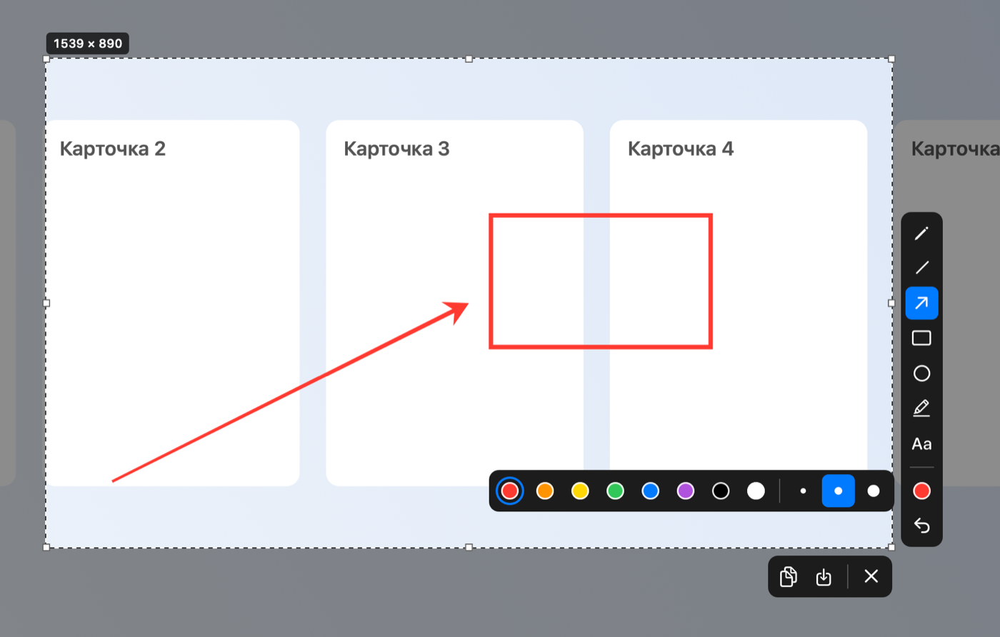

# ShotMark

Скриншотер для macOS по мотивам Lightshot. Нажимаете ⇧⌘9, выделяете область, дорисовываете стрелку или рамку, жмёте ⌘C — картинка уже в буфере обмена.



Lightshot мне очень нравится, но после обновления macOS пользоваться им не получается. Поэтому сделал замену с той же механикой и теми же клавишами (облака, как у prnt.sc, здесь нет: снимки никуда не уходят с компьютера). Нужна macOS 14 или новее, сборка универсальная — Apple Silicon и Intel.

## Что умеет

- ⇧⌘9 замораживает все экраны, область выделяется мышью. Её можно двигать, тянуть за края и сдвигать стрелками клавиатуры на пиксель (с Shift — на 10 пунктов).
- Инструменты: стрелка, прямоугольник, круг или овал, линия, карандаш, маркер и текст. С зажатым Shift получаются квадрат, ровный круг и линии под 45°.
- Восемь цветов и три толщины в палитре, колесом мыши толщина меняется от 1 до 30. Цвет и толщина запоминаются до следующего снимка.
- ⌘C кладёт в буфер PNG и TIFF в полном Retina-разрешении и закрывает редактор. ⌘S сохраняет в PNG или JPEG.
- С несколькими мониторами каждый экран замораживается отдельно, а выделение остаётся одно.
- Живёт в строке меню, в Dock не появляется. Там же включается автозапуск при входе в систему.

## Клавиши

| Клавиша | Действие |
|---|---|
| ⇧⌘9 | сделать скриншот |
| ⌘C или Enter | скопировать в буфер и закрыть |
| ⌘S | сохранить в файл |
| ⌘Z | отменить последнюю пометку |
| Esc | закрыть без сохранения |
| A / R / E / L / P / M / T | стрелка / прямоугольник / круг / линия / карандаш / маркер / текст |
| Shift при рисовании | квадрат, ровный круг, линии под 45° |
| Колесо мыши | толщина линии |
| Стрелки | сдвинуть область (с Shift — на 10 пунктов) |

Буквенные клавиши работают и на русской раскладке. В тексте Enter завершает надпись, Shift+Enter переносит строку.

## Установка

1. Скачайте `ShotMark-1.0.zip` со страницы [Releases](https://github.com/kobozevomd/ShotMark/releases/latest), распакуйте и перенесите `ShotMark.app` в «Программы».
2. Приложение не подписано сертификатом разработчика Apple, поэтому первый запуск macOS заблокирует. Снимите блокировку одной командой в Терминале:
   ```bash
   xattr -dr com.apple.quarantine /Applications/ShotMark.app
   ```
   Или после неудачного запуска откройте «Системные настройки → Конфиденциальность и безопасность», в разделе «Безопасность» нажмите «Все равно открыть».
3. Запустите ShotMark и дайте доступ к записи экрана: «Системные настройки → Конфиденциальность и безопасность → Запись экрана и системного звука», включите ShotMark. Если macOS предложит перезапустить приложение, соглашайтесь.
4. В строке меню появится значок с видоискателем. Жмите ⇧⌘9.

Время от времени macOS переспрашивает, разрешить ли ShotMark и дальше снимать экран напрямую, в обход системного окна выбора. Так система ведёт себя со всеми сторонними скриншотерами, разрешайте.

## Сборка из исходников

Нужны только Command Line Tools (`xcode-select --install`), Xcode ставить не обязательно.

```bash
git clone https://github.com/kobozevomd/ShotMark.git
cd ShotMark
./build.sh --install
```

`./build.sh` собирает универсальное приложение в `build/`, флаг `--install` кладёт его в `/Applications` и запускает, `--zip` упаковывает архив для релиза. Подпись ad-hoc, поэтому после каждой пересборки macOS заново спрашивает доступ к записи экрана.

Для отладки есть режимы `--demo` (редактор на синтетической картинке, доступ к экрану не нужен), `--render-test out.png` и `--ui-test out.png` (рендер тестовой сцены в файл).

## Как устроено

Около 1600 строк на Swift и AppKit, без зависимостей. Снимок делает ScreenCaptureKit, горячую клавишу ловит Carbon `RegisterEventHotKey`, поэтому разрешение на универсальный доступ не нужно. Пометки рисуются векторно поверх замороженного снимка и впечатываются в картинку в момент копирования, в родном разрешении экрана.

Чего нет: нарисованную пометку нельзя подвинуть или поменять, только отменить через ⌘Z.

## Лицензия

MIT
